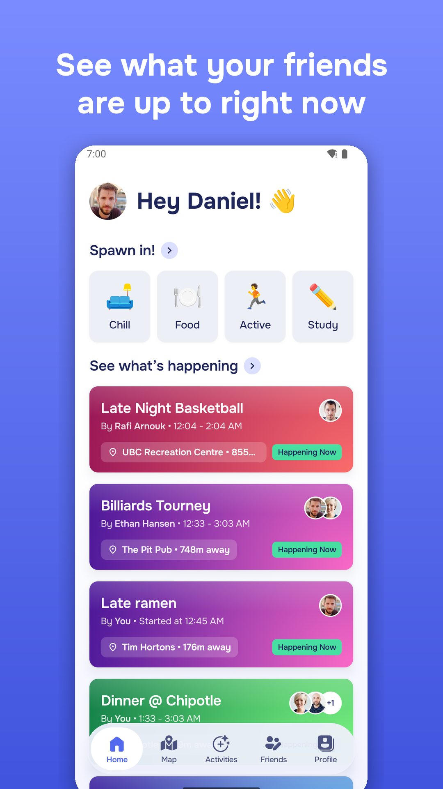
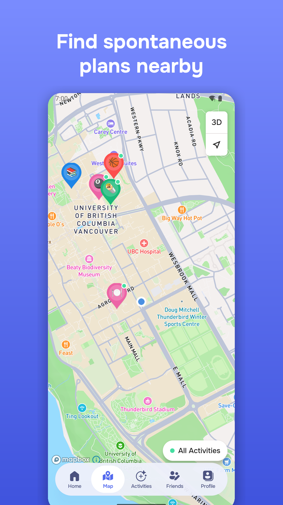
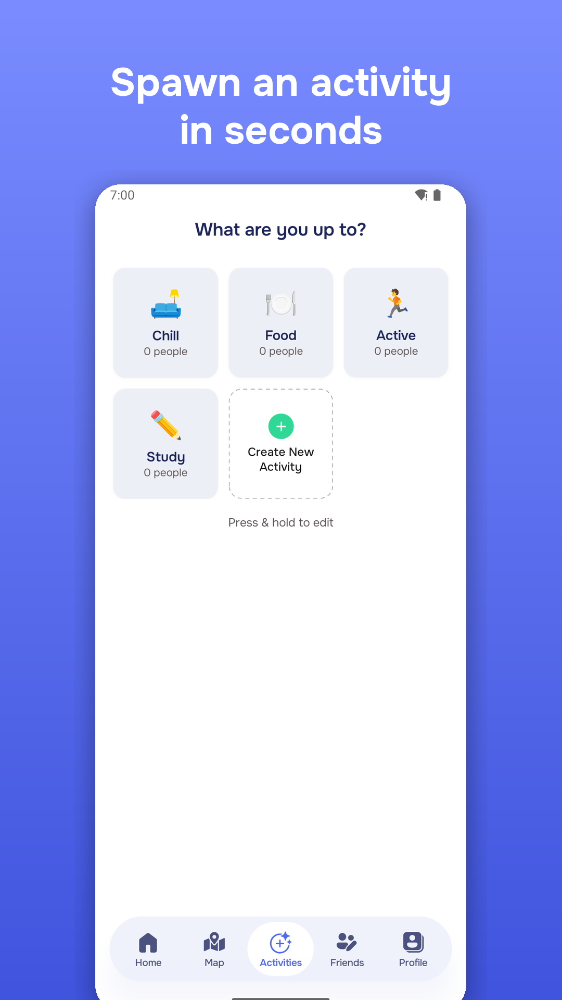
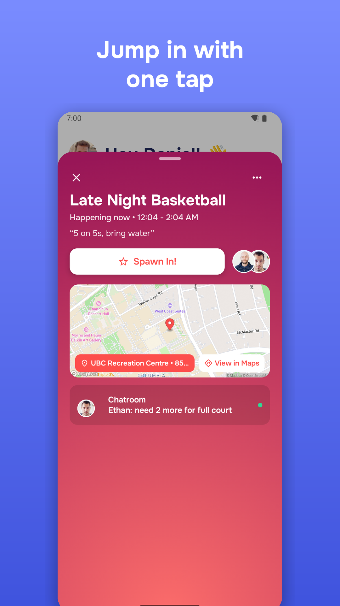
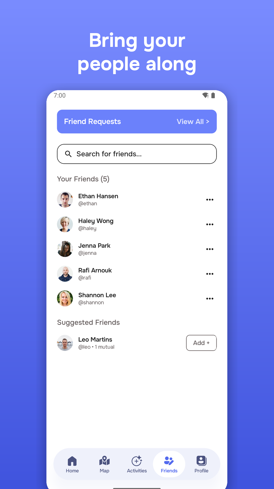
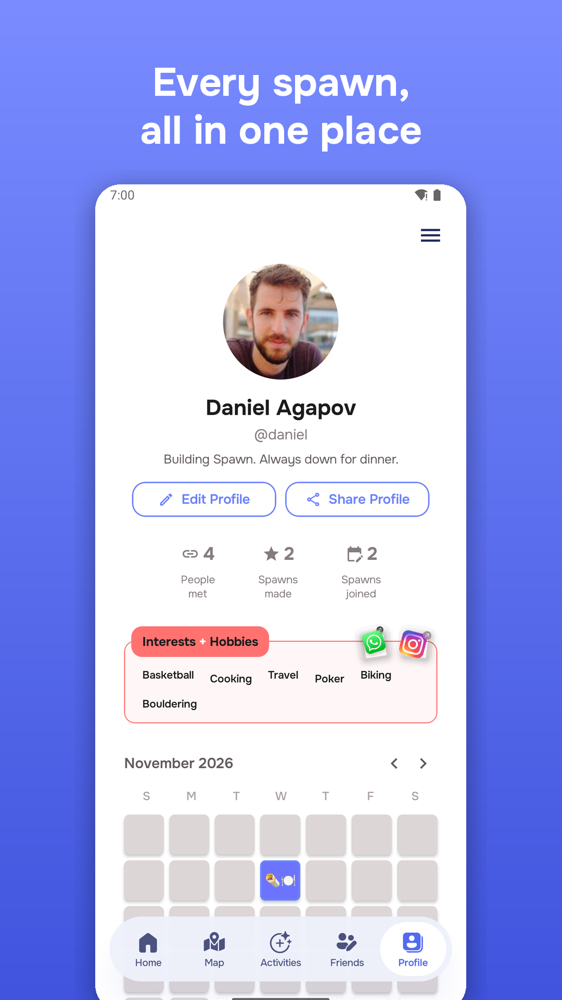

# Spawn-App-Android-Kotlin
 Spawn for Android, made in Kotlin, and connected to Spawn-App-Back-End (REST API). 

### Table  of Contents:
- [Current App State](#current-app-state)
- [Entity Relationship Diagram](#entity-relationship-diagram)
- [General Links](#general-links)

# Running it

You need Android Studio (or just the Android SDK) and JDK 17.

```bash
cd Spawn-Android
./gradlew installDebug        # builds and installs on a running emulator/device
```

Debug builds talk to production by default. To use a backend on your machine, add this to `Spawn-Android/local.properties`:

```
API_BASE_URL=http://10.0.2.2:8080/api/v1/
```

(`10.0.2.2` is your computer as seen from the emulator.) `tools/seed_local_backend.py` fills a local backend with test users, friends, activities and chats.

Google sign-in works out of the box: the build uses the backend's Web OAuth client ID, and Google Cloud has Android clients for `com.danielagapov.spawn` with both the debug key and the upload key. A new machine's debug key needs its SHA-1 added as another Android client before Google sign-in works there.

# Releasing to Google Play

```bash
cd Spawn-Android
./gradlew installMinifiedLocal   # optional: the R8-minified release code against your local backend
./gradlew bundleRelease          # signed .aab in app/build/outputs/bundle/release/
```

Signing reads `Spawn-Android/keystore.properties` (gitignored). The store listing text, data-safety answers, graphics and the full checklist are in [`Spawn-Android/store/LISTING.md`](Spawn-Android/store/LISTING.md).

# General Links
- [Back-end Repo](https://github.com/Daggerpov/Spawn-App-Back-End)
- [Jetpack Compose MVVM playlist](https://youtube.com/playlist?list=PLzZEuVaFb9Exi-pc8qtHBrrLg8bUn-TP6&si=DQWrtxvFNACAxyBk)
- [Kotlin Fundamentals](https://developer.android.com/courses/pathways/android-basics-compose-unit-2-pathway-1#codelab-https://developer.android.com/codelabs/basic-android-kotlin-compose-classes-and-objects)

# Current App State
  
  

# Entity Relationship Diagram


